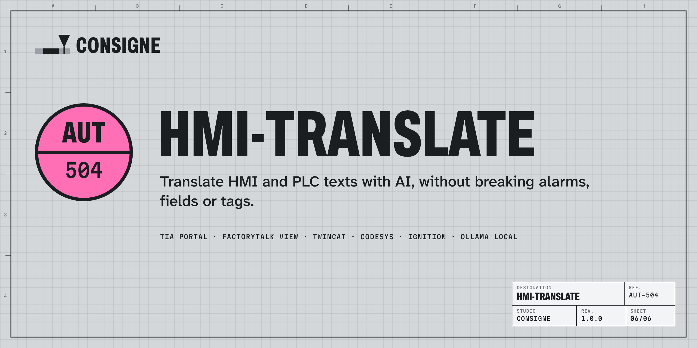

# hmi-translate

AI translation of HMI and PLC texts (alarms, screens, buttons, PLC comments) that keeps alarm variables, field lengths, tags and your glossary intact, and gives back files your engineering tool imports as they are.

*Version française : [LISEZMOI.md](LISEZMOI.md).*

**Download the free trial** from [Releases](../../releases): every feature, 500 texts per project. Windows package with Node.js included (unzip, double-click `Start HMI Translate.cmd`), or portable package for Linux / macOS (Node.js 20+).

**Licences**: Engineer (one person) or Machine builder (5 people), 12 months: [consigne.gumroad.com/l/hmi-translate](https://consigne.gumroad.com/l/hmi-translate).

## Formats

| Tool | Files |
|---|---|
| TIA Portal / WinCC | project texts and HMI alarms (.xlsx) |
| FactoryTalk View ME / SE | language files (Unicode .txt) |
| TwinCAT HMI | .localization |
| TwinCAT 3 PLC / CODESYS | localization .pot / .po |
| Ignition | Translation Manager .xml / .properties |
| Any tool | .xlsx or .csv with one column per language |

## Engines

Ollama on your own computer (nothing leaves it), OpenAI-compatible APIs, Anthropic Claude API, DeepL API with your own key, or translation memory only.

## Documentation

* [User guide](docs/GUIDE.md) · [Guide d'utilisation](docs/GUIDE.fr.md)
* [Changelog](CHANGELOG.md)

## Limits

The formats are implemented from the vendors' documentation and the structure of their export files, and tested on files built to that structure. Import into a copy of your project first. Machine translation can be wrong: safety texts must be reviewed by a person fluent in the language before commissioning.

This repository holds the documentation and the trial downloads. hmi-translate is not open source: see [LICENSE](LICENSE). Product names are trademarks of their owners; hmi-translate is not affiliated with them.

Support: support@consignestudio.fr
